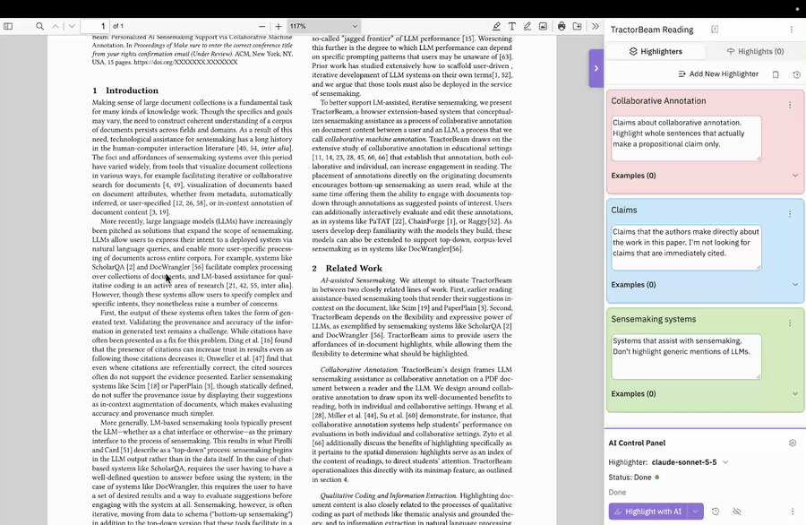

# TractorBeam - Customizable Reading Support for PDFs with Collaborative Machine Annotation



TractorBeam is a browser extension that allows users to define, iterate on, and evaluate AI
highlighting systems on PDFs. These highlight systems can serve a variety of purposes — reading
support and document indexing, acting like a sort of semantic ctrl-F; rapid
prototyping for information extraction systems, e.g. extracting all instances of names,
materials, or abstract concepts from a document; and adversarial refinement of your own
understanding of a domain: updating your mental model based on the differences between how you
think of it and how an AI highlights it.

## Background

TractorBeam takes the form of a _collaborative annotation_ tool: a tool that allows a group of
users to jointly highlight the contents of a document. Systems like this (including
[Hypothesis](https://hypothes.is) and [Genius](https://genius.com)) allow shared meaning making
through these highlights: people can see what other people found interesting, notes and comments
can facilitate discussion, and the highlights are direct responses to the text that _remain
grounded to that text_: users are reading comments alongside the text that originated them.

These properties of collaborative annotation are also really useful for AI: hallucinations are
less of a concern if you're seeing an AI's results in light of the original document, and
evaluating whether an AI is doing a good job is a lot easier when you see what it's drawing from.
I wrote about some of the benefits of collaborative annotation for machine learning in a paper
at the [Science and Technology of Augmented Reading Workshop](https://chi-star-workshop.github.io/)
at CHI 2026, and you can find that paper 
[here](<https://chi-star-workshop.github.io/src/assets/pdf/papers/CHI_STAR_26__Collaborative_Annotation_as_an_Interface_Metaphor_for_Personalizable_AI_Reading_Support%20(3)%20-%20Sireesh%20Gururaja.pdf>).
TractorBeam and it's preliminary user study will also be a poster at UIST 2026(
[paper](https://siree.sh/assets/pdf/tractorbeam_uist_26_paper.pdf)|
[poster](https://siree.sh/assets/pdf/tb_uist_poster.pdf)), and 
you can find a more complete version of the study 
[here.](https://siree.sh/assets/pdf/tractorbeam_paper_27.pdf)

While TractorBeam doesn't support collaboration with other users yet, it frames AI as a
collaborative annotator on the same documents you read, in a very common, existing PDF reader
(Mozilla's [pdf.js](https://mozilla.github.io/pdf.js/)).
The AI highlights are clearly marked as separate from yours, and you can choose to use them to
either better reflect your mental model in instances, or to refine the model's behavior and
re-run it.

## What It Does

At its core, TractorBeam functions as an annotation tool: you can select text in a PDF, and
choose to keep it as a highlight, optionally with some notes that you write for yourself.
However, to better reflect the structure that that annotation might take for different users,
TractorBeam imposes a little more structure. In the following bullets, we discuss key terms in
the TractorBeam conceptual model.

- **Projects**: all TractorBeam annotation happens inside a _project_, which is just
  a collection of things that you might care about in a domain. We explicitly use this level so
  that you can use TractorBeam in multiple different ways without reconfiguring it each time.
  For instance, I might have one project that helps me read NLP papers, and another that helps
  with materials science papers. Both of these can coexist, and be switched between, even on the
  same paper. Each project has a name that can freely be changed, and a list of classes. Projects
  are not intended to be document-specific; rather, they represent a model for thinking about a
  collection of similar documents. Projects also allow for project-wide instructions, which are 
  for things that apply broadly to all documents you might read with it.
- **Highlighters**: Each project  is composed of a list of _highlighters_, which describe  
  particular things you might be looking for. This can be something as specific as "materials", 
  or as loose as "things I find interesting". Every highlight you make in the PDF viewer needs 
  to belong to a highlighter; we indicate this visually by the highlighter's color, which then 
  applies automatically to each associated highlight. Highlighters consist of a name, a 
  description, a color, and a list of examples.
- **Examples**: An _example_ represents a highlight that you make on a document that belongs
  to a specific class, that can optionally have associated notes. Instances have an associated
  class (and thereby a schema), and will be rendered automatically on a document when you load
  it. Instances also allow you to specify whether a highlight is a _negative_ example of a class,
  i.e. something that might look or be mistaken for a class, but should not be included. Because
  they are explicitly created by users, instances are rendered as _underlines_ in the document,
  rather than true highlights, so as not to draw your attention.

These three concepts cover the _user_ annotation model for TractorBeam: these are for highlights
that we consider "confirmed", i.e. the user has explicitly indicated that these highlights are
useful or interesting to them, and that they'd like to keep track of them. Machine highlights,
however, are _provisional_: until the user explicitly indicates that they are correct (or
incorrect enough to warrant being a negative instance), they are transient. Machine highlights
are not rendered on a document until you ask for model highlights or restore an earlier set of
model highlights.

Machine highlights are displayed as squiggly highlights in the context of the PDF to indicate
their provisionality. Machine highlights can be "promoted" into instances by clicking on them
and using the modal dialog that pops up.

<details>
<summary><b>What does the machine highlight process do?</b></summary>

The machine highlight process has three phases:

1. **Layout Analysis and Text Extraction**: We run a deterministic algorithm called xy-cut, which
   splits a page into visual regions. This will likely be replaced with a dedicated layout
   analysis model, because it is the weakest part of the pipeline. After these visual regions
   are detected, we extract the text in them. The calculated visual regions can be viewed with
   the layout button in the model control panel.
2. **Machine Annotation**: after the text is extracted, we create a system prompt for an LLM
   using the current schema, its current classes and their instances. This system prompt is used
   to create ML suggestions for things that should be highlighted.
3. **Display**: Suggested ML annotations are mapped back onto the PDF, using a rough heuristic
   that guesses the positions of specific characters.

</details>

<details>
<summary><b>Where is the data?</b></summary>

TractorBeam is aiming at being a primarily local tool. This means that all the data you create —
schemas, classes, and instances — live on your computer, and we aim to make the data exportable and
interoperable with a number of formats: [Hypothesis](https://hypothes.is) and [Margin](https://margin.at)
for annotations, HuggingFace for NER training, and plain CSV. More concretely, this data is
stored in your browser's [`IndexedDB`](https://developer.mozilla.org/en-US/docs/Web/API/IndexedDB_API).

For machine annotations, only choosing to use a remote AI annotation backend causes data to ever
leave your computer, and that data would then be handled by the LLM provider.
**Do not use a remote AI backend for data that you're not sure can be sent to Anthropic**.

You can point the AI annotation to a model that you run locally, for example with tools like 
Ollama and vLLM by reconfiguring the URL that the model points at.

</details>

## Getting Started

TractorBeam currently does not have a distributable version. If you're a developer interested in
giving the tool a spin, clone the repo, then run `pnpm install` before `pnpm run dev`. The
latter command will open up an instance of Chrome, which will allow testing the extension.

To launch the extension, open a PDF in the Chrome window, and then click the TractorBeam
extension icon. This should open the extension with the sidebar open and set to a test schema.

### Choosing an ML Backend

TractorBeam currently supports any OpenAI- or Anthropic-compatible endpoint in a 
bring-your-own-key setup. This means that you can use OpenAI or Anthropic themselves, or any 
other models behind a similar endpoint, including ones you host or run yourself through tools 
like [Ollama](https://ollama.com) or [vLLM](https://vllm.ai/). We also have an experimental mode 
that allows you to use models in-browser via [WebLLM](https://webllm.mlc.ai/). Setting an 
endpoint URL and an API key can be done by clicking the gear icon in the AI control panel.

## Development

TractorBeam is built as an MV3 extension using [WXT](https://wxt.dev), a Vite-based framework for
extension development. It is written in TypeScript+React, with TailwindCSS for styles and
shadcn/ui as a component provider.

The extension has four contexts:

- the instrumented PDF viewer
- the "schema manager", a standalone view that allows you to see cross-PDF annotations in one place
- an [offscreen document](https://developer.chrome.com/docs/extensions/reference/api/offscreen)
  in which the ML code runs
- a lightweight background script that coordinates messaging
  between the PDF Viewer and the offscreen document, and manages the lifecycle for the extension.

The instrumented PDF viewer is a vendored-in version of the pdf.js viewer, with multiple react
roots grafted on for particular functionality:

- A root for the drawer on the side that provides instance views and navigation
- A root for the highlights that sit on top of the PDF viewer
- A root for the popovers that allow editing instances and promoting machine highlights in the
  context of the viewer.

The extension stores user annotation data in IndexedDB, persisted via event sourcing to enable
time-travel debugging and comparison. Configuration data (model configuration, user UI state,
etc.) is stored in Chrome local storage.

### Project Layout

```
src/
├── entrypoints/              # the four runtime contexts
│   ├── background.ts           # lifecycle: PDF redirect, offscreen mgmt, open manager tab
│   ├── pdfjs-additions/        # instrumented pdf.js viewer — drawer, highlights, popovers
│   ├── offscreen/              # ML inference: prompt building + per-backend runner routing
│   └── schema-manager/         # standalone tab: cross-PDF annotations + deep-links
├── lib/
│   ├── definitions.ts          # core domain types (Schema / Class / Instance)
│   ├── schema-reducer.ts       # annotation state transitions
│   ├── schema-storage.ts       # event-sourced IndexedDB (snapshot + append-only log)
│   ├── messaging/              # typed cross-context messages + request correlation
│   └── ml/                     # per-backend runners, prompting, NER parsing
├── components/              # React UI (viewers, highlights, model controls, shadcn/ui)
├── contexts/                # React context (e.g. DrawerContext)
├── hooks/                   # persisted-reducer: dispatch → IndexedDB
└── app-config.ts            # schema version + storage config

public/                      # vendored pdf.js viewer + pdfjs-init.js (the JS↔React bridge)
docs/architecture/           # design rationale & in-progress direction
```
 

## Acknowledgements

- [**pdf.js**](https://github.com/mozilla/pdf.js) (Mozilla) — the PDF viewer is a vendored-in
  copy of pdf.js, used under its Apache 2.0 license.
- [**WebLLM**](https://github.com/mlc-ai/web-llm), [**Ollama**](https://ollama.com), and
  [**Transformers.js**](https://github.com/huggingface/transformers.js) — the local/on-device
  machine annotation backends.
- [**WXT**](https://wxt.dev) — the extension framework.
- [**shadcn/ui**](https://ui.shadcn.com), [**Tailwind CSS**](https://tailwindcss.com), and
  [**React**](https://react.dev) — the UI layer.
